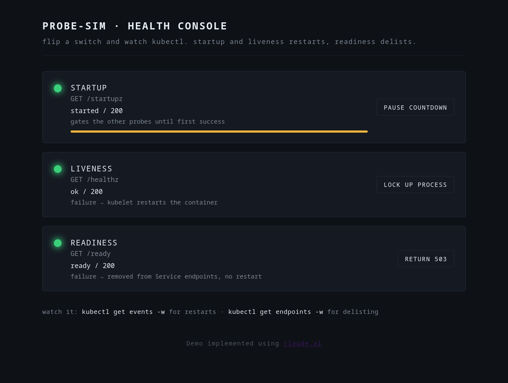

# k8s-probe-simulator



A tiny Kubernetes probe simulator for teaching and demos. It serves the three probe endpoints a kubelet checks - startup, liveness, and readiness - and gives you a web console to fail each one on demand, so you can watch the difference between what restarts a container and what only removes it from a Service.

**AI Usage**: the Code in this Repo was implemented using [claude.ai](https://claude.ai).

## Why?

In Kubernetes, there are three probe types with distinct effects and purposes:

- **Startup** gates the other two probes until the app has finished booting, ensures Pod has started properly
- **Liveness** failure makes the kubelet **restart** the container, used to detect a crashed container
- **Readiness** failure makes the endpoints controller **delist** the pod from its Service, without restarting it, used to detect e.g. an overloaded process

This simulator lets you trigger each condition live from a browser and observe the cluster react.

## Configuration

Both are optional, read from the environment:

- `STARTUP_DELAY_SECONDS` - seconds before startup completes (default 15)
- `PORT` - port to listen on (default 8080)

## Building

```bash
sudo docker build -t local/probe-sim:latest .
```

## Deploying to Kubernetes

`manifest.yml` contains a Deployment and a Service. Apply and port-forward the service to reach the console:

```bash
kubectl apply -f manifest.yml
kubectl rollout status deploy/probe-sim
kubectl port-forward deploy/probe-sim 8080:8080
# open http://localhost:8080
```

## Try the demos

Open the console, then trip a channel and watch the cluster in another terminal.

**Readiness delists without restarting.** Hit *return 503* on readiness. The pod stays `Running` and `RESTARTS` stays at 0, but it drops out of the Service:

```bash
kubectl get pod -w                 # READY flips to 0/1, no restart
kubectl get endpoints probe-sim    # the pod's address disappears
```

**Liveness restarts the container.** Hit *lock up process* on liveness. After the probe fails its threshold, the kubelet kills and restarts the container:

```bash
kubectl get pod -w                 # RESTARTS climbs
```

**Startup gates the rest.** 

Pause the startup countdown. The pod sits at `0/1` and never becomes ready, because the startupProbe never succeeds and the other probes stay gated behind it. Release it and the pod comes up.

## Watching events for the pod

Probe failures surface as `Warning` events with reasons like `Unhealthy` and `Killing`:

```bash
POD=$(kubectl get pod -l app=probe-sim -o jsonpath='{.items[0].metadata.name}')
kubectl get events --field-selector involvedObject.name=$POD --sort-by='.lastTimestamp' -w
```